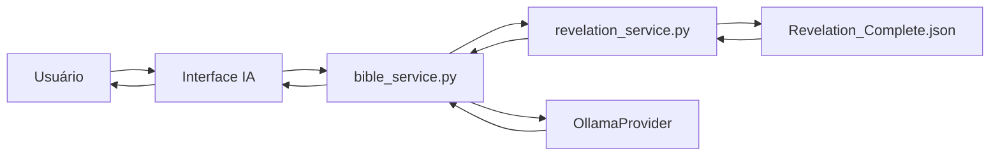

# Integração do Apocalipse — Sistema Completo

## 📊 Visão Geral

Este documento descreve a integração completa do **Apocalipse (Ἀποκάλυψις Ἰωάννου)** nos dois sistemas do projeto:

1. **Site Institucional Público** (aculpaedasovelhas.com)
2. **Plataforma de IA Privada** (Sistema de Estudos Bíblicos)

---

## 🎯 Objetivos Alcançados

### ✅ Site Institucional

- [x] Página interativa com visualizador grego/português
- [x] Modo Leitura (texto corrido)
- [x] Modo Interlinear (palavra-por-palavra)
- [x] Busca em tempo real (grego e português)
- [x] Navegação por capítulos (1-22)
- [x] Estatísticas do livro
- [x] API JavaScript para acesso aos dados

### ✅ Plataforma de IA

- [x] Serviço Python para acesso aos dados
- [x] Integração com BibleService
- [x] Métodos para consulta de versículos
- [x] Busca textual
- [x] Análise interlinear via IA
- [x] Suporte a tradução TEA (Tradução Extremamente Rígida)

---

## 📁 Estrutura de Arquivos

### Site Institucional (`Site - aculpaedasovelhas.com/`)

```
Site - aculpaedasovelhas.com/
├── biblia.html                    # Atualizado com badge "✅ COMPLETO"
├── apocalipse-completo.html       # Nova página interativa (CRIADA)
├── api/
│   └── apocalipse.js              # API JavaScript (CRIADA)
└── data/
    ├── Revelation_Complete.json   # 4.45 MB — 405 versículos (COPIADO)
    └── Revelation_Index.json      # Índice compacto (COPIADO)
```

### Plataforma de IA (`Plataforma de IA/`)

```
Plataforma de IA/
└── src/
    └── services/
        ├── bible_service.py       # Atualizado com métodos Apocalipse
        └── revelation_service.py  # Novo serviço Python (CRIADO)
```

---

## 🔧 Componentes Criados

### 1. **apocalipse.js** (API JavaScript)

**Localização**: `Site - aculpaedasovelhas.com/api/apocalipse.js`

**Funções Públicas**:

```javascript
// Carregamento
await loadRevelationData();

// Metadados
getBookInfo();
getChaptersIndex();
getStatistics();

// Consultas
getChapter(chapterNumber);
getVerse(chapterNumber, verseNumber);

// Busca
searchVerses(query, (limit = 20));
searchGlossary(greekWord);

// Análise
getInterlinear(chapter, verse);
```

**Uso**:

```javascript
<script src="api/apocalipse.js"></script>
<script>
    const chapter = await getChapter(1);
    console.log(chapter.verses);
</script>
```

---

### 2. **apocalipse-completo.html** (Interface Pública)

**Localização**: `Site - aculpaedasovelhas.com/apocalipse-completo.html`

**Recursos**:

- ✅ Navegação por 22 capítulos
- ✅ Toggle entre Modo Leitura e Modo Interlinear
- ✅ Busca em tempo real (300ms debounce)
- ✅ Estatísticas do livro (versículos, termos, média)
- ✅ Visualização grego + português
- ✅ Análise morfológica palavra-por-palavra
- ✅ Breadcrumb navegação
- ✅ Tema claro/escuro
- ✅ Responsivo mobile

**Modos de Visualização**:

1. **Modo Leitura**:

```html
<div class="verse-container">
  <span class="verse-number">1</span>
  <div class="greek-text">Ἀποκάλυψις Ἰησοῦ Χριστοῦ...</div>
  <div class="literal-translation">Revelação de Jesus Cristo...</div>
</div>
```

2. **Modo Interlinear**:

```html
<table class="interlinear-table">
  <thead>
    <tr>
      <th>#</th>
      <th>Grego (Original)</th>
      <th>Lema</th>
      <th>Morfologia</th>
      <th>Tradução</th>
    </tr>
  </thead>
  <tbody>
    <tr>
      <td>1</td>
      <td>Ἀποκάλυψις</td>
      <td>ἀποκάλυψις</td>
      <td>N-NSF</td>
      <td>Revelação</td>
    </tr>
    ...
  </tbody>
</table>
```

---

### 3. **revelation_service.py** (Serviço Python)

**Localização**: `Plataforma de IA/src/services/revelation_service.py`

**Classe Principal**: `RevelationService`

**Métodos**:

```python
# Inicialização
service = RevelationService(data_path=None)  # Auto-detecta

# Metadados
info = service.get_book_info()

# Consultas
chapter = service.get_chapter(1)
verse = service.get_verse(1, 1)
text = service.get_verse_text(1, 1, lang='pt')

# Busca
results = service.search_verses("Jesus", limit=20)
occurrences = service.search_greek_word("Ἰησοῦς")

# Glossário
entry = service.get_glossary_entry("ἀποκάλυψις")

# Análise
interlinear = service.get_interlinear(1, 1)

# Estatísticas
stats = service.get_statistics()

# Navegação
index = service.get_chapters_index()
ref = service.format_reference(1, 1)  # "Apocalipse 1:1"
```

**Auto-detecção de Arquivo**:

```python
possible_paths = [
    # Plataforma de IA
    Path(__file__).parent.parent.parent / "data" / "Revelation_Complete.json",
    # Site institucional
    Path(__file__).parent.parent.parent.parent / "Site - aculpaedasovelhas.com" / "data" / "Revelation_Complete.json",
    # Diretório de tradução
    Path(__file__).parent.parent.parent.parent / "Bíblia Nova Belem" / "ptbr_translation" / "NT" / "Revelation_Complete.json"
]
```

---

### 4. **bible_service.py** (Integração com IA)

**Localização**: `Plataforma de IA/src/services/bible_service.py`

**Novos Métodos**:

```python
class BibleService:
    def __init__(self):
        # ...
        self.revelation_service = RevelationService()

    # Consulta com formato IA-friendly
    def get_revelation_verse(self, chapter: int, verse: int,
                            include_greek: bool = False) -> str:
        """
        Retorna:
        📖 Apocalipse 1:1
        🇬🇷 Grego: Ἀποκάλυψις Ἰησοῦ Χριστοῦ...
        🇧🇷 Tradução TEA: Revelação de Jesus Cristo...
        """

    # Busca formatada
    def search_revelation(self, query: str, limit: int = 10) -> str:
        """
        Retorna:
        🔍 Busca: 'Jesus' — 3 resultado(s)

        🇧🇷 **Apocalipse 1:1**
        Revelação de Jesus Cristo...
        """

    # Análise morfológica
    def get_revelation_interlinear(self, chapter: int, verse: int) -> str:
        """
        Retorna:
        📊 Análise Interlinear — Apocalipse 1:1
        Método TEA (Tradução Extremamente Rígida)

         1. Ἀποκάλυψις       [ἀποκάλυψις  ] N-NSF      → Revelação
         2. Ἰησοῦ            [Ἰησοῦς      ] N-GSM      → de Jesus
        ...
        """
```

---

## 🔄 Fluxo de Dados

### Site Institucional (Fluxo Frontend)


1. Usuário acessa `apocalipse-completo.html`
2. JavaScript carrega `api/apocalipse.js`
3. API faz `fetch('../data/Revelation_Complete.json')`
4. Dados são cacheados em memória
5. Interface renderiza capítulos/versículos dinamicamente

### Plataforma de IA (Fluxo Backend)



1. Usuário faz pergunta sobre Apocalipse
2. `BibleService` recebe requisição
3. Consulta `RevelationService` para dados
4. `RevelationService` carrega JSON (cache em memória)
5. Dados retornam para `BibleService`
6. IA (Ollama) processa com contexto do versículo
7. Resposta formatada retorna ao usuário

---

## 📖 Estrutura dos Dados

### Revelation_Complete.json

```json
{
  "book_id": 27,
  "book_name": "Revelation",
  "total_chapters": 22,
  "total_verses": 405,
  "author": "Anderson Belem Costa",
  "translation_method": "Belém AnC-Ipísis Iliteris Fidelity Method",
  "rigidity_level": "TEA (Tradução Extremamente Rígida)",

  "chapters": [
    {
      "chapter": 1,
      "title": "Introdução e Visão de Cristo",
      "verses": [
        {
          "verse": 1,
          "greek_text": "Ἀποκάλυψις Ἰησοῦ Χριστοῦ...",
          "literal_translation": "Revelação de Jesus Cristo...",
          "readable_translation": "A Revelação de Jesus Cristo...",
          "words": [
            {
              "position": 1,
              "original": "Ἀποκάλυψις",
              "lemma": "ἀποκάλυψις",
              "morphology": "N-NSF",
              "translation": "Revelação"
            }
            // ... mais palavras
          ]
        }
        // ... mais versículos
      ]
    }
    // ... mais capítulos
  ],

  "greek_glossary": {
    "ἀποκάλυψις": {
      "transliteration": "apokalypsis",
      "meaning": "revelação, descobrimento",
      "occurrences": 18
    }
    // ... 282 termos
  }
}
```

---

## 🚀 Como Usar

### 1. Site Institucional

**Passo 1**: Acesse a página Bíblia

```
https://aculpaedasovelhas.com/biblia.html
```

**Passo 2**: Clique em "🔥 Apocalipse" (badge ✅ COMPLETO)

**Passo 3**: Navegue pelos capítulos

**Recursos**:

- 📖 **Modo Leitura**: Ver texto completo grego + português
- 📊 **Modo Interlinear**: Análise palavra-por-palavra com morfologia
- 🔍 **Busca**: Digite qualquer termo grego ou português
- 📊 **Estatísticas**: 22 capítulos, 405 versículos, 282 termos

---

### 2. Plataforma de IA

**Exemplo 1**: Consultar versículo específico

```python
from src.services.bible_service import BibleService

service = BibleService()

# Consulta simples
verse_text = service.get_revelation_verse(1, 1)
print(verse_text)
# Output:
# 📖 Apocalipse 1:1
# Revelação de Jesus Cristo que Deus a Ele deu...

# Consulta com grego
verse_full = service.get_revelation_verse(1, 1, include_greek=True)
print(verse_full)
# Output:
# 📖 Apocalipse 1:1
#
# 🇬🇷 Grego: Ἀποκάλυψις Ἰησοῦ Χριστοῦ...
#
# 🇧🇷 Tradução TEA: Revelação de Jesus Cristo...
```

**Exemplo 2**: Buscar termo

```python
results = service.search_revelation("dragão", limit=5)
print(results)
# Output:
# 🔍 Busca: 'dragão' — 5 resultado(s)
#
# 🇧🇷 **Apocalipse 12:3**
# E foi visto outro sinal no céu: e eis um grande dragão vermelho...
#
# 🇧🇷 **Apocalipse 12:4**
# E sua cauda arrasta a terça parte das estrelas do céu...
```

**Exemplo 3**: Análise interlinear

```python
analysis = service.get_revelation_interlinear(1, 1)
print(analysis)
# Output:
# 📊 Análise Interlinear — Apocalipse 1:1
# Método TEA (Tradução Extremamente Rígida)
#
#  1. Ἀποκάλυψις       [ἀποκάλυψις  ] N-NSF      → Revelação
#  2. Ἰησοῦ            [Ἰησοῦς      ] N-GSM      → de Jesus
#  3. Χριστοῦ          [Χριστός     ] N-GSM      → Cristo
# ...
#
# 💬 Tradução literal: Revelação de Jesus Cristo que Deus a Ele deu...
```

---

## 🎨 Personalização

### Tema Dark/Light

O site suporta toggle automático entre temas:

```css
[data-theme="dark"] {
  --color-canvas-default: #0d1117;
  --color-fg-default: #e6edf3;
  --color-accent-emphasis: #1f6feb;
}

[data-theme="light"] {
  --color-canvas-default: #ffffff;
  --color-fg-default: #1f2328;
  --color-accent-emphasis: #0969da;
}
```

### Fontes

- **Grego**: Times New Roman, serif (máxima compatibilidade)
- **Interface**: System fonts (performance)
- **Plataforma**: Space Grotesk, IBM Plex Sans

---

## 📊 Estatísticas do Apocalipse

| Métrica                      | Valor   |
| ---------------------------- | ------- |
| **Capítulos**                | 22      |
| **Versículos**               | 405     |
| **Palavras totais**          | ~10,000 |
| **Termos únicos (grego)**    | 282     |
| **Média palavras/versículo** | ~24.7   |
| **Tamanho arquivo JSON**     | 4.45 MB |

---

## 🔒 Método TEA

**TEA = Tradução Extremamente Rígida**

Princípios:

1. ✅ **Palavra-por-palavra**: Cada palavra grega traduzida individualmente
2. ✅ **Ordem preservada**: Sequência das palavras mantida
3. ✅ **Ipísis Iliteris**: "Pelas próprias letras" — máxima fidelidade
4. ✅ **Morfologia completa**: Caso, número, gênero, tempo verbal preservados

Exemplo:

```
Grego:    Ἀποκάλυψις Ἰησοῦ     Χριστοῦ
         N-NSF      N-GSM      N-GSM
Literal: Revelação  de Jesus   Cristo

TEA: "Revelação de Jesus Cristo"
(mantém ordem + morfologia)
```

---

## 🧪 Testes

### Testar API JavaScript (Browser Console)

```javascript
// Carregar dados
await loadRevelationData();

// Testar metadados
console.log(getBookInfo());

// Testar capítulo
const cap1 = await getChapter(1);
console.log(cap1.verses.length); // 20 versículos

// Testar busca
const results = await searchVerses("Jesus", 5);
console.log(results);

// Testar interlinear
const analysis = await getInterlinear(1, 1);
console.log(analysis);
```

### Testar Serviço Python

```bash
cd "C:\Projetos\Projeto - O Livrinho\Plataforma de IA"
python -c "from src.services.revelation_service import RevelationService; s = RevelationService(); print(s.get_book_info())"
```

**Output esperado**:

```
✅ Apocalipse carregado: 405 versículos
{
  'title': 'Apocalipse de João',
  'greek_title': 'Ἀποκάλυψις Ἰωάννου',
  'total_chapters': 22,
  'total_verses': 405,
  ...
}
```

---

## 🐛 Troubleshooting

### Problema: "Arquivo não encontrado"

**Solução**: Verificar caminhos

```python
# revelation_service.py tenta 3 locais:
1. Plataforma de IA/data/
2. Site - aculpaedasovelhas.com/data/
3. Bíblia Nova Belem/ptbr_translation/NT/

# Confirmar existência:
import os
print(os.path.exists("Site - aculpaedasovelhas.com/data/Revelation_Complete.json"))
```

### Problema: "JSON não carrega no browser"

**Solução**: Verificar CORS e paths relativos

```javascript
// Em apocalipse.js
const response = await fetch("../data/Revelation_Complete.json");

// Path deve ser relativo à localização do HTML
// apocalipse-completo.html está em raiz
// data/ também está em raiz
// Logo: '../data/' está ERRADO
// Correto: './data/' ou 'data/'
```

**FIX NECESSÁRIO**:

```javascript
// TROCAR em api/apocalipse.js linha ~15:
const response = await fetch("./data/Revelation_Complete.json");
```

### Problema: "Busca muito lenta"

**Solução**: Limitar resultados

```javascript
// JavaScript
const results = await searchVerses(query, 10); // Máx 10 resultados

// Python
results = service.search_verses("termo", (limit = 10));
```

---

## 📚 Próximos Passos

### Site Institucional

- [ ] Adicionar download PDF do Apocalipse
- [ ] Implementar notas de rodapé
- [ ] Criar versão de impressão
- [ ] Adicionar compartilhamento de versículos
- [ ] Criar bookmarks/favoritos

### Plataforma de IA

- [ ] Adicionar Apocalipse ao índice FAISS
- [ ] Treinar modelo específico com Apocalipse
- [ ] Implementar perguntas sobre versículos específicos
- [ ] Criar estudos guiados por capítulo
- [ ] Integrar com intertextuality_engine

### Outros Livros

- [ ] Traduzir Evangelho de João (21 capítulos)
- [ ] Traduzir Daniel (12 capítulos)
- [ ] Criar índice unificado de todos os livros

---

## 👥 Créditos

- **Tradução**: Anderson Belem Costa
- **Método**: Belém AnC-Ipísis Iliteris Fidelity Method (TEA)
- **Fonte**: SBL Greek New Testament (MorphGNT)
- **Desenvolvimento**: AN Agent + Anderson Belem Costa
- **Licença**: International Public Domain Biblical Codices

---

## 📞 Suporte

Para dúvidas ou sugestões sobre a integração:

- **Site**: aculpaedasovelhas.com
- **Email**: contato@aculpaedasovelhas.com
- **Projeto**: "O Livrinho - A Culpa é das Ovelhas"

---

**Última Atualização**: 2025-01-23  
**Versão**: 1.0.0 — Apocalipse Completo Integrado ✅
